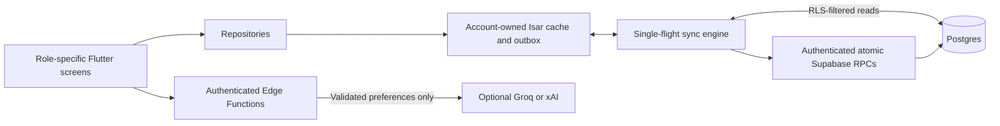

# LifeLink


Flutter FYP for donor, patient, reception, laboratory and administrator workflows, backed by Supabase and an account-isolated Isar offline cache.


The UI retains the existing blood-drop logo and uses the supplied Figma image references and `apple-DESIGN.md`. Native desktop and mobile layouts share a consistent theme and navigation. All roles sign in with email and password; the stored profile determines their dashboard. Donor/patient selection is only for registration.


## Run and verify


Use the Flutter version compatible with `pubspec.yaml` and keep `pubspec.lock` committed.


```sh

flutter pub get

flutter run -d windows

flutter test

flutter analyze

flutter build windows --debug

flutter build apk --debug

```


Windows builds require the Visual Studio C++ toolchain, including ATL for secure session storage. Android Kotlin incremental compilation is disabled to avoid cache failures when this D: checkout uses the C: Pub cache. The analyzer currently reports 48 experimental-API warnings in generated Isar code; do not edit those generated methods by hand.


```sh

npx deno check supabase/functions/manage-users/index.ts supabase/functions/meal-plan/index.ts

npx deno test --allow-env supabase/functions/meal-plan/validation_test.ts

```


The database verification script is `supabase/tests/security_and_sync.sql`. It creates synthetic fixtures inside a transaction and rolls them back. The incremental migration targets the existing connected database; read the setup notes before deploying to another project.


## Architecture





Privacy and cookie/storage notices are available before sign-in and from each portal. Admin > Settings changes their public operator details. AI meal drafts require explicit consent, clinician suitability confirmation and doctor review. The feature remains unavailable until a server-side provider key is configured; never put that key in Flutter.


See [security review, configuration and deployment limitations](docs/SECURITY_AND_SETUP.md) and the [public release gate](docs/PUBLIC_RELEASE_GATE.md). Use synthetic data for the FYP. The intended release includes real patient records and uninterrupted reception/lab work during internet outages. Current offline support covers some locally cached visits and lab results, but not cross-workstation handoff, patient search, or inventory; the clinical cache is also unencrypted, and child patients do not have a safe non-login record workflow. This build is not approved for public clinical use.

For the first intended real-world deployment in Balochistan, follow the [facility, software and app-store release path](docs/BALOCHISTAN_RELEASE_PATH.md). Facility licensing, clinical sign-off and production security remain separate from building an APK.

For a beginner-friendly plan to connect reception, lab and admin through a clinic server, see the [clinic LAN setup roadmap](docs/CLINIC_LAN_SETUP_ROADMAP.md). It separates physical wiring from the server and app work still required.

The current two-Windows-laptop cable test is recorded in the [direct Ethernet guide](docs/DIRECT_ETHERNET_TWO_WINDOWS_LAPTOPS.md); the [router, switch and future CBC guide](docs/ROUTER_AND_CBC_NETWORK_GUIDE.md) explains how to expand it without assuming the analyzer's interface.


## Pakistan legal and privacy audit

See [the legal audit](docs/LEGAL_AUDIT_PAKISTAN.md) for all six checklist items, code evidence, processor inventory and operator tasks. The FYP uses a server-enforced 13+ registration rule, bundled fonts, no analytics/marketing/billing, and public Privacy, Terms, storage and copyright pages. Pakistan is the default operator country; Supabase currently stores data in Mumbai, outside Pakistan. Use synthetic data pending legal, clinical and security review.
